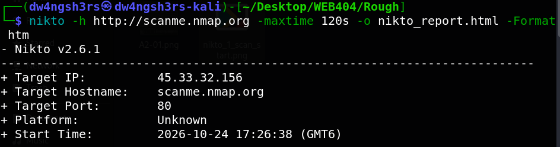
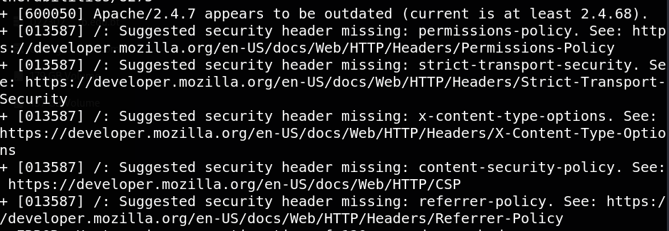
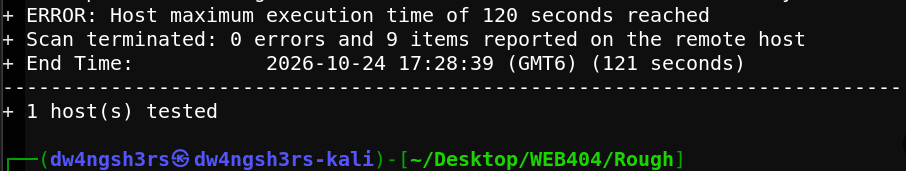
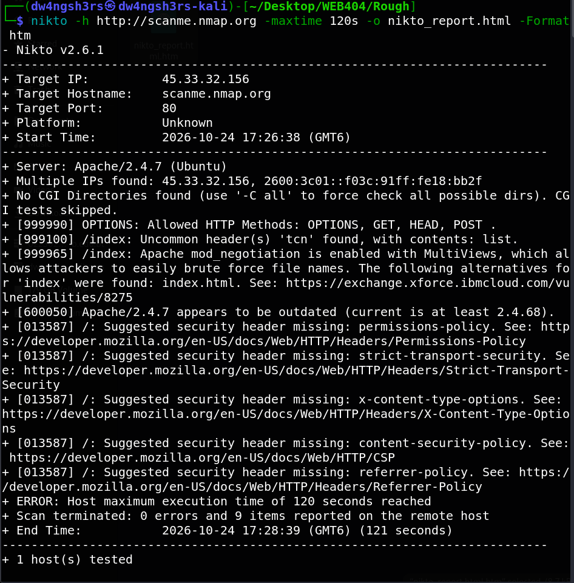

# Assignment 1 — Web Vulnerability Assessment using Nikto

**Name:** Dechen Wangdra Sherpa
**Student No:** 02230281
**Module:** Web Application Security (WEB404)

---

## 1. Aim

To conduct a vulnerability assessment on a sample website using the Nikto web server scanner and to interpret the findings reported by the tool.

## 2. Introduction

Nikto is an open-source web server scanner that tests a target server against a large database of known issues. It checks for outdated server software, insecure configurations, dangerous HTTP methods, missing security headers, and other common weaknesses. It does not exploit anything — it simply probes the server and reports potential problems, much like a home inspector who checks every door and window and hands back a list of weak points.

For this assessment, the scan was run from **Kali Linux** (Nikto v2.6.1) against **`scanme.nmap.org`**, a host published by the Nmap project specifically for legal scanning practice.

## 3. Tool and Target

| Item | Detail |
|------|--------|
| Tool | Nikto v2.6.1 |
| Platform | Kali Linux |
| Target hostname | scanme.nmap.org |
| Target IP | 45.33.32.156 |
| Target port | 80 (HTTP) |
| Server software | Apache/2.4.7 (Ubuntu) |

> **Note on authorisation:** `scanme.nmap.org` is explicitly provided by the Nmap project for scan testing, so the scan is authorised and legal.

## 4. Implementation

### 4.1 Command used

```bash
nikto -h http://scanme.nmap.org -maxtime 120s -o nikto_report.html -Format htm
```

- `-h` — specifies the target host.
- `-maxtime 120s` — caps the scan at 120 seconds so it terminates cleanly (a full Nikto scan can otherwise run for a long time).
- `-o nikto_report.html -Format htm` — saves the results as an HTML report.

### 4.2 Scan start

The scan connected to the target and displayed the banner showing the target IP, hostname, port, and start time.



### 4.3 Scan execution

Nikto then probed the server and printed each finding (lines beginning with `+`), including the outdated server version and several missing security headers.



### 4.4 Scan completion

After reaching the 120-second limit, the scan terminated cleanly and printed the summary.



The complete scan output in a single view:



## 5. Results and Interpretation

The scan completed with **365 requests, 0 errors, and 9 findings** on 1 host. The key findings are interpreted below.

| # | Finding (as reported by Nikto) | What it means | Risk |
|---|--------------------------------|---------------|------|
| 1 | **Apache/2.4.7 is outdated** (current is at least 2.4.68) | The server runs an old Apache version that may contain known, unpatched vulnerabilities. | High |
| 2 | **mod_negotiation / MultiViews enabled** | Lets an attacker brute-force file names more easily (e.g. `index` resolved to `index.html`). | Medium |
| 3 | **Allowed HTTP methods: OPTIONS, GET, HEAD, POST** | The OPTIONS method exposes which methods the server accepts — useful reconnaissance for an attacker. | Low |
| 4 | **Uncommon header `tcn` found** | A side effect of content negotiation being enabled; minor information disclosure. | Low |
| 5 | **Missing `permissions-policy` header** | Browser cannot restrict powerful features (camera, geolocation, etc.). | Low–Medium |
| 6 | **Missing `strict-transport-security` header** | No HSTS, so connections are not forced over HTTPS — vulnerable to downgrade attacks. | Medium |
| 7 | **Missing `x-content-type-options` header** | Browser may MIME-sniff responses, enabling some content-type based attacks. | Low–Medium |
| 8 | **Missing `content-security-policy` header** | No CSP, which is a key defence against cross-site scripting (XSS). | Medium |
| 9 | **Missing `referrer-policy` header** | The full referring URL may leak to third-party sites. | Low |

### 5.1 Summary of findings

The most serious issue is the **outdated Apache version**, since known exploits may exist for it. The **five missing security headers** together show that the server has not been hardened against common browser-based attacks such as XSS, clickjacking, and protocol downgrade. The **mod_negotiation** setting slightly eases reconnaissance.

## 6. Recommendations

1. **Update Apache** to the latest stable 2.4.x release to patch known vulnerabilities.
2. **Add the missing security headers** — at minimum `Content-Security-Policy`, `Strict-Transport-Security`, and `X-Content-Type-Options`.
3. **Disable `mod_negotiation` MultiViews** if content negotiation is not required.
4. **Restrict HTTP methods** to only those the application needs.

## 7. Conclusion

The Nikto scan successfully identified 9 potential vulnerabilities on the target server, the most significant being an outdated Apache installation and a set of missing HTTP security headers. The exercise demonstrated how an automated scanner can quickly surface server-side weaknesses and how its output is interpreted to assess risk and recommend fixes.
